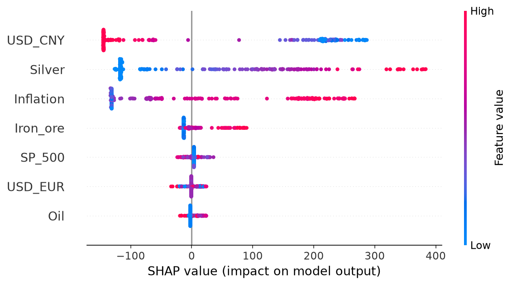
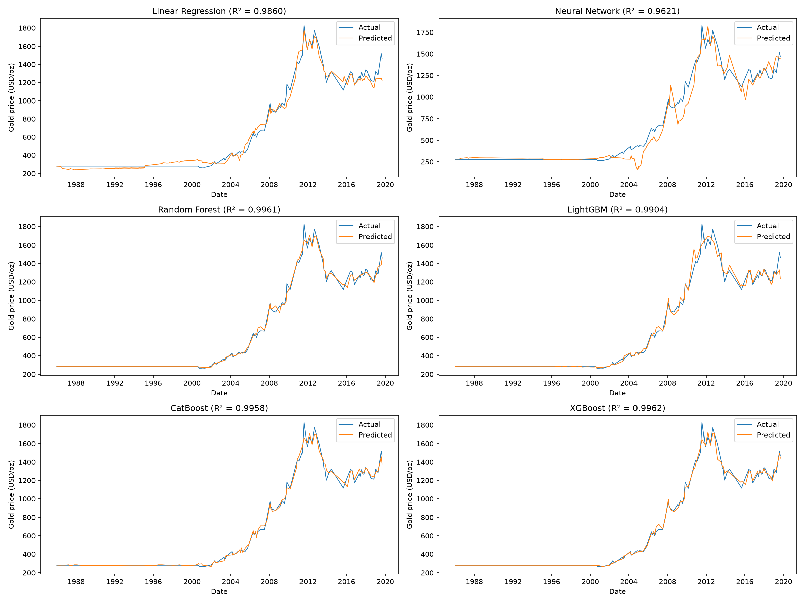

# Gold Price Forecasting with XGBoost and SHAP

Which economic factors move the price of gold, and how well can a model predict it?
This project compares **six regression models** on **34 years of monthly data (1986–2019)** and uses
**SHAP** to explain what drives the best model's predictions.

[](https://colab.research.google.com/github/srikarasudan/gold-price-forecasting-xgboost-shap/blob/main/gold_price_forecasting.ipynb)


## Key results

**XGBoost was the most accurate model**, explaining 99.6% of the variation in gold prices on months it had not seen.

| Model | RMSE | MAE | R² |
|---|---:|---:|---:|
| **XGBoost** | **29.00** | **14.11** | **0.9962** |
| Random Forest | 29.67 | 14.96 | 0.9961 |
| CatBoost | 30.77 | 16.92 | 0.9958 |
| LightGBM | 46.26 | 21.46 | 0.9904 |
| Linear Regression | 55.90 | 41.47 | 0.9860 |
| Neural Network (MLP) | 92.09 | 55.71 | 0.9621 |

*60/40 train/test split with no overlap, 408 months in total. RMSE and MAE are in the same units as the gold price (USD).*

**What drives gold prices (SHAP):** three indicators account for most of XGBoost's predictions.

| Rank | Indicator | Mean \|SHAP\| | Effect |
|---:|---|---:|---|
| 1 | USD/CNY exchange rate | 167.3 | A stronger dollar against the yuan pushes gold **down** |
| 2 | Silver price | 131.7 | Gold moves **with** silver |
| 3 | Inflation | 131.3 | Higher inflation pushes gold **up** |
| 4 | Iron ore | 17.0 | Small positive effect |
| 5–7 | S&P 500, USD/EUR, Oil | < 7 | Little effect |





## Data

`data/gold_macro_monthly_1986_2019.csv`: 408 monthly rows, January 1986 to December 2019.

| Column | Description |
|---|---|
| `Gold` | Gold price (**target**) |
| `Silver` | Silver price |
| `Oil` | Crude oil price |
| `USD_EUR` | US dollar / euro exchange rate |
| `USD_CNY` | US dollar / Chinese yuan exchange rate |
| `SP_500` | S&P 500 index |
| `Iron_ore` | Iron ore price |
| `Inflation` | Inflation (price index) |

## Method

1. **Explore:** descriptive statistics, skewness, kurtosis, correlation matrix with p-values.
2. **Split:** 60% of months for training and 40% for testing, with no overlap.
3. **Scale:** standardise features for Linear Regression and the Neural Network.
4. **Train six models:** Linear Regression, MLP Neural Network, Random Forest, LightGBM, CatBoost, XGBoost.
5. **Evaluate:** RMSE, MSE, MAE and R² on the test months.
6. **Explain:** SHAP importance, summary, dependence and waterfall plots for XGBoost.

## Limitations and next steps

- **The test months are picked at random**, so the model always has neighbouring months in its training data.
  This measures how well the indicators *explain* gold prices, not how well the model can predict the future.
- **A strict time-based test is much harder.** Training on 1986–2006 and testing on 2006–2019 gives R² below 0
  for every model, because gold rose to about $1,800 while the training data never went above about $650,
  and tree-based models can't predict values outside the range they were trained on.
- **Next steps:** predict monthly *changes* (returns) instead of price levels, and use walk-forward
  (time-series) cross-validation.

## How to run

Click **Open in Colab** above, or run it locally:

```bash
git clone https://github.com/srikarasudan/gold-price-forecasting-xgboost-shap.git
cd gold-price-forecasting-xgboost-shap
pip install -r requirements.txt
jupyter notebook gold_price_forecasting.ipynb
```

The notebook writes its tables and charts to `results/`.

## Project structure

```
├── gold_price_forecasting.ipynb   # full analysis: EDA → models → SHAP
├── data/
│   └── gold_macro_monthly_1986_2019.csv
├── results/                       # model scores, SHAP values and charts
├── docs/
│   ├── report.pdf                 # course project report
│   └── slides.pdf                 # presentation
└── requirements.txt
```

## About

Course project for **CSE425 – Machine Learning Essentials**, B.Tech. Computer Science & Business Systems,
SASTRA Deemed University (November 2025).

The report and slides in `docs/` are the original submission. The notebook has since been corrected so that
training and test data no longer overlap (the original reported R² 0.9999 for XGBoost because the test
months were also used for training).

**Based on:** Ben Jabeur, S., Mefteh-Wali, S., & Viviani, J.-L. (2024). *Forecasting gold price with the
XGBoost algorithm and SHAP interaction values.* Annals of Operations Research, 334, 679–699.
[doi:10.1007/s10479-021-04187-w](https://doi.org/10.1007/s10479-021-04187-w)

**Author:** Srikarasudan P R · [LinkedIn](https://www.linkedin.com/in/srikarasudan-p-r-4b4423212/)
